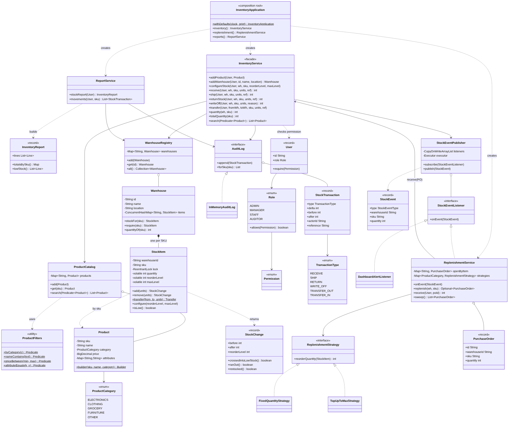
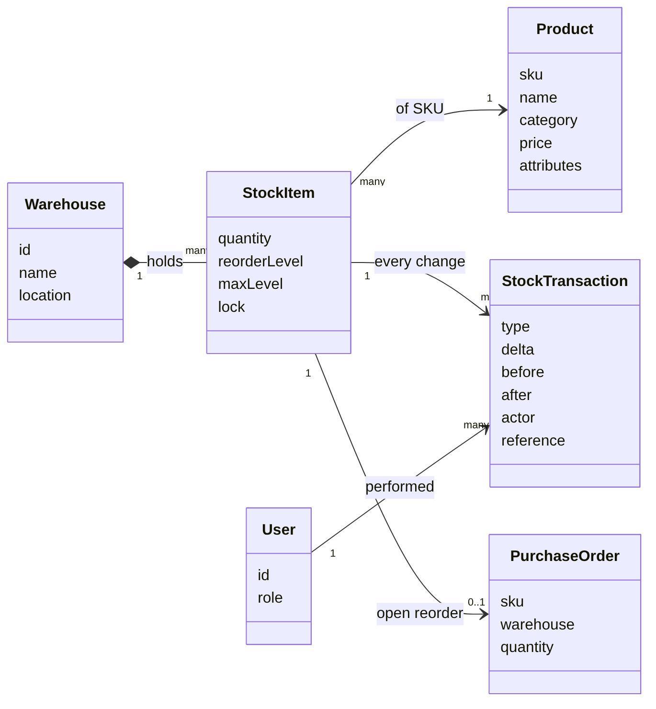
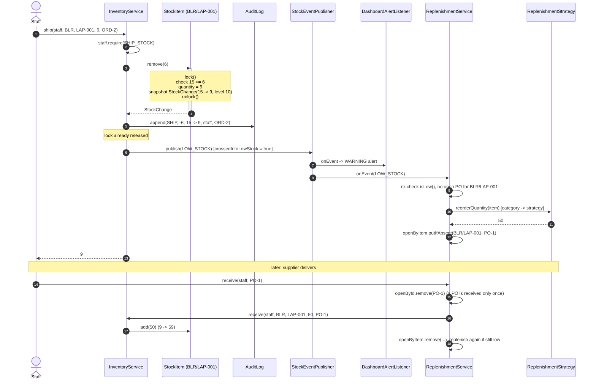
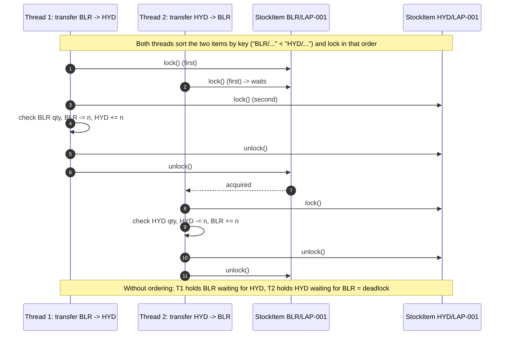

# Inventory Management System: Low-Level Design Study Notes

*Target: SDE-2 LLD round. Java 17. Written 12 Oct 2026.*

These notes take what the two resources you're following do well (Strategy for replenishment, Observer for low-stock alerts, a Builder for products, per-SKU locking from the ChatGPT discussion) and fix what they get wrong or leave out: quantity living on the shared `Product`, alerts firing on every sale, duplicate reorders, no real transfer, no audit trail, no access control, and a Singleton doing everyone's job. The design is kept to what you can draw and code in a 45–60 minute round.

The working code sits next to this file. Run `./run.sh` for the demo and `./run.sh test` for the tests (18 tests, JDK only).

---

## Contents

1. [Requirements (say these first)](#1-requirements-say-these-first)
2. [The core ideas](#2-the-core-ideas)
3. [Class diagram](#3-class-diagram)
4. [The entities, and why they look like this](#4-the-entities-and-why-they-look-like-this)
5. [Stock movements: receive, ship, return, write-off](#5-stock-movements-receive-ship-return-write-off)
6. [Transfers between warehouses (two locks, no deadlock)](#6-transfers-between-warehouses-two-locks-no-deadlock)
7. [Low-stock alerts (Observer)](#7-low-stock-alerts-observer)
8. [Replenishment (Strategy + idempotent purchase orders)](#8-replenishment-strategy--idempotent-purchase-orders)
9. [Audit trail](#9-audit-trail)
10. [Access control](#10-access-control)
11. [Search and reports](#11-search-and-reports)
12. [Multithreading and concurrency](#12-multithreading-and-concurrency)
13. [Design patterns used (and the ones left out)](#13-design-patterns-used-and-the-ones-left-out)
14. [SOLID, mapped to this design](#14-solid-mapped-to-this-design)
15. [Review of the resources](#15-review-of-the-resources)
16. [Extensions and scaling](#16-extensions-and-scaling)
17. [Tests](#17-tests)
18. [Interview playbook](#18-interview-playbook)
19. [One-page cheat sheet](#19-one-page-cheat-sheet)

---

## Project layout

```
Inventory-Management-LLD/
├── Inventory-Management-LLD-Study-Notes.md   <- this file
├── run.sh                                    <- ./run.sh (demo)   ./run.sh test (tests)
├── docs/                                     <- diagrams (.png, .svg, Mermaid .mmd source)
└── src/
    ├── main/java/com/lld/inventory/
    │   ├── model/          Product (+Builder), ProductCategory, Warehouse, StockItem, StockChange,
    │   │                   User, Role, Permission
    │   ├── store/          ProductCatalog, WarehouseRegistry, ProductFilters
    │   ├── audit/          AuditLog, InMemoryAuditLog, StockTransaction, TransactionType
    │   ├── events/         StockEventPublisher, StockEventListener, StockEvent, StockEventType,
    │   │                   DashboardAlertListener
    │   ├── replenishment/  ReplenishmentStrategy, FixedQuantityStrategy, TopUpToMaxStrategy,
    │   │                   PurchaseOrder, ReplenishmentService
    │   ├── service/        InventoryService (facade), ReportService, InventoryReport
    │   ├── exception/      InventoryException + InsufficientStock, NotFound, DuplicateEntity, AccessDenied
    │   ├── InventoryApplication.java   <- composition root (wires everything)
    │   └── Main.java                   <- end-to-end demo, including a 16-thread race
    └── test/java/com/lld/inventory/InventoryTests.java   <- 18 tests, JDK only
```

---

## 1. Requirements (say these first)

**Functional**

| # | Requirement |
|---|---|
| F1 | **Multiple warehouses**; each can stock **many products** of different **categories** (electronics, clothing, grocery, …). |
| F2 | A **product catalog**: SKU (unique id), name, category, price, category-specific attributes. |
| F3 | Stock operations: **receive** (inbound from supplier), **ship** (outbound for an order), **return** (customer return), **write-off** (damaged/expired), **transfer** between warehouses. |
| F4 | Each (warehouse, SKU) has a **reorder level**. Falling to or below it raises a **low-stock alert** and triggers **replenishment**. |
| F5 | **Replenishment strategies** are pluggable (bulk batch, top-up to max, …) and can differ per category. |
| F6 | **Audit trail**: every quantity change is recorded (who, what, when, before/after, reference). |
| F7 | **Access control**: roles limit who can do which operation. |
| F8 | **Search/filter** products; **reports** on stock status and movement. |

**Non-functional**

| Concern | How the design handles it |
|---|---|
| **No overselling / negative stock** under concurrent orders (the big one) | Check-and-update is one critical section per `StockItem` (§12) |
| Transfers are all-or-nothing and can't deadlock | Both item locks held, always taken in key order (§6) |
| Different SKUs / warehouses never block each other | Lock per (warehouse, SKU); no global lock anywhere |
| Reads (dashboards, reports) don't block writes | `volatile` quantity + `ConcurrentHashMap`; reads are lock-free |
| One alert and one purchase order per shortage, not one per sale | Edge-triggered events (§7) + one open PO per item (§8) |
| Extensible rules | Replenishment is a Strategy; listeners are Observers; roles are an enum table |
| Money | `BigDecimal`, scale 2, never `double` |
| Testable time | `java.time.Clock` injected |

**Out of scope (say so):** order management and reservations (holding stock for an unpaid cart), batch/lot/expiry tracking, bin locations inside a warehouse, a real supplier integration, a database. §16 shows where each would fit.

**Clarifying questions worth asking:**

- Is the reorder level per product, or per product **per warehouse**? (Per warehouse; a big DC and a dark store need different levels.)
- Can stock go negative (backorders)? (We say no.)
- Should a shipment ever be split across warehouses? (Out of scope; order fulfilment would pick a warehouse first.)
- Do we need reservations, i.e. stock held between "add to cart" and "paid"? (Out of scope, but §16.1 shows the change.)
- Is replenishment automatic (place a purchase order) or only an alert to a buyer? (Automatic, with an alert too.)
- Which operations need which role?

---

## 2. The core ideas

Three sentences carry most of the design:

> **1. `Product` is WHAT a thing is (catalog, immutable, shared); `StockItem` is HOW MANY of it one warehouse holds.** Quantity, reorder level and the lock live on `StockItem`, one per (warehouse, SKU).

> **2. Every change to a `StockItem` is check + update + snapshot inside its own lock.** The snapshot (`StockChange` before → after) drives the audit row and the alerts, and both happen *after* the lock is released.

> **3. Alerts are edge-triggered and reorders are idempotent.** A low-stock event fires only on the change that crosses the reorder level, and at most one purchase order is open per (warehouse, SKU), no matter how many threads notice the shortage.

Everything else is ordinary layering around those three.

---

## 3. Class diagram

### 3.1 Full picture



*Zoomable: `docs/class-diagram.svg`. Mermaid source: `docs/class-diagram.mmd`.*

Read it top to bottom: **`InventoryApplication` (wiring) → `InventoryService` (facade) / `ReplenishmentService` / `ReportService` → stores, audit log, event publisher → the model (`Warehouse` ◆ `StockItem` → `Product`)**.

Relationships and what they mean:

- **Warehouse ◆— StockItem** (composition): a stock item doesn't exist outside its warehouse. One per SKU the warehouse has ever held. It is never deleted at zero (§4.4).
- **StockItem → Product by SKU**: a reference by id, not by object. The catalog is the single owner of `Product`.
- **ProductCatalog o— Product**, **WarehouseRegistry o— Warehouse**: in-memory stores (repositories) keyed by id, both `ConcurrentHashMap`.
- **InventoryService → interfaces / stores only**: `AuditLog` is an interface; listeners are behind `StockEventPublisher`. Concrete choices are made in `InventoryApplication`.
- **StockEventListener ◁ DashboardAlertListener, ReplenishmentService**: the two observers.
- **ReplenishmentStrategy ◁ FixedQuantityStrategy, TopUpToMaxStrategy**: chosen per `ProductCategory`.
- **ReplenishmentService → InventoryService**: only to book a delivered purchase order in through the normal `receive` path (so it is authorised, audited and evented like any other receipt).

### 3.2 The whiteboard version (draw this first)



Six boxes. Draw these in the first 10 minutes, then add the services, strategies and listeners around them.

### 3.3 One shipment, from order to purchase order



Notice where the lock ends (step 4). The audit write and the events come after it.

---

## 4. The entities, and why they look like this

### 4.1 Product vs StockItem: the most important split

Both resources put `quantity` and `threshold` on `Product`:

```java
// codewithAryan
public abstract class Product { private String sku; ... private int quantity; private int threshold; }
warehouse1.addProduct(laptop, 15);   // stores the SAME Product object in the warehouse map
```

If the same laptop is stocked in two warehouses, both maps hold the **same object**, so a shipment from one changes the count in the other. And a single `threshold` can't be right for both a 10,000 m² DC and a corner dark store. So we split it:

| `Product` (catalog) | `StockItem` (per warehouse, per SKU) |
|---|---|
| sku, name, category, price, attributes | quantity, reorderLevel, maxLevel |
| immutable, shared freely between threads | mutable, guarded by its own lock |
| one per SKU in the whole business | one per (warehouse, SKU) |

This is the same idea as "flight vs seat" or "show vs seat" in booking systems: the description and the countable instance are different objects.

### 4.2 Product: immutable, built with a Builder

```java
Product laptop = Product.builder("LAP-001", "Laptop", ELECTRONICS)   // required fields
        .price("899.99")                                             // optional, BigDecimal, scale 2
        .attribute("brand", "Dell").attribute("warrantyMonths", "24")
        .build();
```

- Required fields go in `builder(...)`, optional ones are chained, validation happens once. SKU is trimmed and upper-cased, so `" lap-001"` and `"LAP-001"` are the same product.
- All fields `final`, attributes copied with `Map.copyOf`: safe to share across threads with no locking.
- `equals`/`hashCode` on SKU only.

**Why no `ElectronicsProduct` / `ClothingProduct` subclasses and no `ProductFactory`?** In the resource, the subclasses only add getters/setters for a few fields (`brand`, `size`, `expiryDate`). Nothing in the inventory logic behaves differently per category. A subclass that adds no behaviour is a type tag plus a bag of fields, and `category` + `attributes` covers that without a class (and a `switch` in a factory) per category. Adding "Furniture" is one enum constant.

> **When would subclasses be right?** When a category *behaves* differently inside inventory, e.g. perishables that must ship first-expiry-first-out (FEFO) by batch. That's a real extension (§16.2); say this out loud to show the enum was a choice, not an oversight.

### 4.3 StockItem: the only mutable thing that matters

```java
public final class StockItem {
    private final String warehouseId, sku;
    private final ReentrantLock lock = new ReentrantLock();
    private volatile int quantity;        // written only under lock, read without it
    private volatile int reorderLevel;    // "low" when quantity <= reorderLevel
    private volatile int maxLevel;        // target for a top-up

    public StockChange remove(int units) {
        requirePositive(units);
        lock.lock();
        try {
            if (quantity < units) throw new InsufficientStockException(warehouseId, sku, units, quantity);
            return applyLocked(-units);
        } finally {
            lock.unlock();
        }
    }

    private StockChange applyLocked(int delta) {
        int before = quantity;
        quantity = before + delta;
        return new StockChange(warehouseId, sku, before, quantity, reorderLevel);
    }
}
```

The lock lives **inside** the item, next to the data it protects. The ChatGPT version keeps a separate `Map<String, Lock> skuLocks` in `Warehouse`; that works, but it's two maps that must stay in step, the lock map grows forever, and nothing stops code from touching the item without the lock. Here the only way to change `quantity` is through a method that takes the lock.

### 4.4 Warehouse: owns its items, never deletes them

```java
public final class Warehouse {
    private final Map<String, StockItem> items = new ConcurrentHashMap<>();

    public StockItem stockFor(String sku) {                // atomic get-or-create
        return items.computeIfAbsent(sku, s -> new StockItem(id, s));
    }
    public StockItem require(String sku) { ... }           // throws NotFoundException
    public int quantityOf(String sku) { ... }              // lock-free read
}
```

The resource removes the product from the map when its quantity hits zero. Don't: it throws away the reorder settings, the report can no longer show "out of stock", and a thread that already holds a reference to the old object can keep updating a detached item that the map no longer contains (a lost update). A zero-quantity `StockItem` is a perfectly good state.

### 4.5 StockChange: the snapshot that drives everything after the lock

```java
public record StockChange(String warehouseId, String sku, int before, int after, int reorderLevel) {
    public boolean crossedIntoLowStock() { return before > reorderLevel && after <= reorderLevel; }
    public boolean ranOut()              { return before > 0 && after == 0; }
    public boolean restocked()           { return before == 0 && after > 0; }
}
```

Captured *inside* the lock, so `before`/`after` are exact even with 16 threads hammering the item. Used *outside* the lock for the audit row and the events.

### 4.6 User, Role, Permission

```java
public enum Role {
    ADMIN(EnumSet.allOf(Permission.class)),
    MANAGER(EnumSet.of(CONFIGURE_STOCK, RECEIVE_STOCK, SHIP_STOCK, RETURN_STOCK, TRANSFER_STOCK, WRITE_OFF_STOCK, VIEW_REPORTS)),
    STAFF(EnumSet.of(RECEIVE_STOCK, SHIP_STOCK, RETURN_STOCK)),
    AUDITOR(EnumSet.of(VIEW_REPORTS));
    ...
}
public record User(String id, String name, Role role) {
    public void require(Permission p) { if (!role.allows(p)) throw new AccessDeniedException(this, p); }
}
```

The whole permission table is in one enum. §10 covers why the check is inside the service.

---

## 5. Stock movements: receive, ship, return, write-off

All four are the same four steps, so they share two private methods:

```java
public int ship(User actor, String warehouseId, String sku, int units, String reference) {
    return outbound(actor, Permission.SHIP_STOCK, TransactionType.SHIP, warehouseId, sku, units, reference);
}

private int outbound(User actor, Permission p, TransactionType type, String warehouseId, String sku,
                     int units, String reference) {
    actor.require(p);                                                          // 1. authorise
    String s = skuOf(sku);                                                     //    (must be in the catalog)
    StockChange change = warehouses.get(warehouseId).require(s).remove(units); // 2. change, under the item lock
    record(type, change, -units, actor, reference);                            // 3. audit row
    publishThresholdEvents(change);                                            // 4. events, no lock held
    return change.after();
}
```

`inbound` is the same with `stockFor(s).add(units)` (creates the item on first receipt). Differences between the four:

| Operation | Direction | Permission | Typical reference |
|---|---|---|---|
| `receive` | + | RECEIVE_STOCK | goods receipt note / PO id |
| `returnStock` | + | RETURN_STOCK | RMA number |
| `ship` | − | SHIP_STOCK | order id |
| `writeOff` | − | WRITE_OFF_STOCK | reason ("damaged in handling") |

Damaged returns: either don't receive them, or `returnStock` + `writeOff` so the audit shows both facts.

What gets rejected, and where:

| Bad input | Where | Exception |
|---|---|---|
| units ≤ 0 | `StockItem` | `IllegalArgumentException` |
| SKU not in catalog | `skuOf` | `NotFoundException` |
| warehouse unknown / never stocked this SKU | registry / `require` | `NotFoundException` |
| more than available | `StockItem.remove`, inside the lock | `InsufficientStockException` |
| role not allowed | `User.require` | `AccessDeniedException` |

A rejected operation changes nothing and writes no audit row (tested).

---

## 6. Transfers between warehouses (two locks, no deadlock)

A transfer must be **all or nothing**: never "removed from BLR but not added to HYD". So it holds both items' locks at once:

```java
public static Transfer transfer(StockItem from, StockItem to, int units) {
    StockItem first  = from.key().compareTo(to.key()) < 0 ? from : to;   // fixed global order
    StockItem second = first == from ? to : from;
    first.lock.lock();
    try {
        second.lock.lock();
        try {
            if (from.quantity < units) throw new InsufficientStockException(...);
            return new Transfer(from.applyLocked(-units), to.applyLocked(units));
        } finally { second.lock.unlock(); }
    } finally { first.lock.unlock(); }
}
```



**Why the ordering?** Thread 1 transfers BLR → HYD, thread 2 transfers HYD → BLR at the same moment. If each locked its *source* first, T1 holds BLR and waits for HYD while T2 holds HYD and waits for BLR: deadlock. Sorting by key (`"BLR/LAP-001" < "HYD/LAP-001"`) makes both threads lock BLR first, so one simply waits for the other. This is the classic "lock ordering" fix (same as bank transfers between two accounts). The test runs 2,000 opposite transfers on 16 threads and checks they finish and the total is unchanged.

Alternative worth naming: `tryLock(timeout)` with back-off and retry. It works, but ordering is simpler and can't livelock.

The service writes two audit rows (`TRANSFER_OUT`, `TRANSFER_IN`) with the same reference, and publishes events for both sides (the source may go low; the destination may be restocked).

---

## 7. Low-stock alerts (Observer)

```java
public interface StockEventListener { void onEvent(StockEvent event); }   // observer

public final class StockEventPublisher {                                  // subject
    private final List<StockEventListener> listeners = new CopyOnWriteArrayList<>();
    private final Executor executor;          // Runnable::run (sync) or a thread pool (async)

    public void publish(StockEvent event) {
        for (StockEventListener l : listeners)
            executor.execute(() -> {
                try { l.onEvent(event); }
                catch (RuntimeException e) { System.err.println("listener failed: " + e.getMessage()); }
            });
    }
}
```

Listeners today: `DashboardAlertListener` (alert feed) and `ReplenishmentService` (auto purchase orders). Adding SMS to the buyer, or a "notify me when back in stock" service for customers (listens to `BACK_IN_STOCK`), is a new class plus one `subscribe` line.

Three decisions worth saying out loud:

1. **Edge-triggered, not level-triggered.** The resource calls `notifyObservers` whenever `quantity < threshold`, so with 9 laptops left every further sale sends another alert and another reorder. Here `LOW_STOCK` fires only for the change where `before > reorderLevel && after <= reorderLevel`. Under contention exactly one thread sees that crossing, because `before`/`after` were captured under the lock (tested: 1,000 concurrent shipments → 1 alert, 1 PO).
2. **Published after the lock is released.** Never call foreign code while holding a lock: a slow listener (e-mail) would block every other shipment of that SKU, and a listener that calls back into the service (replenishment does!) could deadlock or re-enter.
3. **A failing listener can't break the stock operation** or the other listeners (caught per listener; tested). In production, use an async executor so a slow e-mail doesn't add latency to `ship()`.

`CopyOnWriteArrayList` fits perfectly: subscribers change almost never, events are published constantly, and iteration needs no lock and can't throw `ConcurrentModificationException`.

---

## 8. Replenishment (Strategy + idempotent purchase orders)

### 8.1 Strategy: how much to reorder

```java
public interface ReplenishmentStrategy {
    int reorderQuantity(StockItem item);
    String name();
}
// "Bulk order": fewer, bigger orders (think EOQ)
public int reorderQuantity(StockItem item) { return batchSize; }                                  // FixedQuantityStrategy
// "Just-in-time": refill to the target, nothing more (good for perishables)
public int reorderQuantity(StockItem item) { return Math.max(0, item.maxLevel() - item.quantity()); }  // TopUpToMaxStrategy
```

Chosen **per category** with a default, not one global `setReplenishmentStrategy()`:

```java
Map.of(ProductCategory.GROCERY, new TopUpToMaxStrategy())   // perishables: top up
new FixedQuantityStrategy(50)                                // everything else: bulk
```

The resource's strategy has `void replenish(Product)` that prints a line. Returning a quantity keeps the strategy a pure function (easy to test) and leaves the side effect (placing an order) to one place.

### 8.2 Exactly one open purchase order per item

Low stock can be noticed by several things at once: the `LOW_STOCK` event, the periodic `sweep()`, a manual trigger, two warehouses' events racing. Without care, each of them places an order.

```java
private final Map<String, PurchaseOrder> openByItem = new ConcurrentHashMap<>();   // "BLR/LAP-001" -> PO

public Optional<PurchaseOrder> replenish(String warehouseId, String sku) {
    StockItem item = warehouses.get(warehouseId).require(sku);
    if (!item.isLow()) return Optional.empty();                         // the signal may be stale
    if (openByItem.containsKey(item.key())) return Optional.empty();    // cheap fast path
    ReplenishmentStrategy s = strategies.getOrDefault(catalog.get(sku).category(), defaultStrategy);
    int qty = s.reorderQuantity(item);
    if (qty <= 0) return Optional.empty();
    PurchaseOrder po = new PurchaseOrder("PO-" + ids.incrementAndGet(), warehouseId, sku, qty, s.name(), clock.instant());
    if (openByItem.putIfAbsent(item.key(), po) != null) return Optional.empty();   // someone else won
    ...
}
```

`putIfAbsent` is the atomic "claim". Losing threads just drop their unsent PO object. (`containsKey` before it is only an optimisation; correctness comes from `putIfAbsent`.) Tested with 32 threads mixing `replenish` and `sweep`: one PO.

### 8.3 Receiving a purchase order

```java
public int receive(User actor, String purchaseOrderId) {
    PurchaseOrder po = openById.remove(purchaseOrderId);        // atomic: received at most once
    if (po == null) throw new NotFoundException("Open purchase order", purchaseOrderId);
    int newQty;
    try { newQty = inventory.receive(actor, po.warehouseId(), po.sku(), po.quantity(), po.id()); }
    catch (RuntimeException e) { openById.put(po.id(), po); throw e; }   // undo the claim
    openByItem.remove(po.itemKey(), po);
    replenish(po.warehouseId(), po.sku());                      // still low? order again
    return newQty;
}
```

- Goes through `InventoryService.receive`, so it's authorised, audited and evented like any receipt.
- The last line matters: if demand outran the delivery (50 arrived but we're still under the reorder level), no new `LOW_STOCK` edge will ever fire, because we never crossed *down*. So we re-check here. The `sweep()` (run on a `ScheduledExecutorService` every few minutes) is the safety net for anything else missed.

---

## 9. Audit trail

```java
public record StockTransaction(long id, Instant at, TransactionType type, String warehouseId, String sku,
                               int delta, int before, int after, String actorId, String reference) { }
```

- **Append-only** (a ledger): rows are never updated or deleted; a mistake is corrected with a new row (e.g. a `RETURN` or `WRITE_OFF`).
- **Self-describing**: `before`/`after`/`delta` on every row, so `after == before + delta` can be checked row by row, and the sum of deltas equals the current quantity. The concurrent test checks both after 400 mixed receives/ships.
- **Who and why**: actor id and a business reference (order id, PO id, RMA, reason).
- `AuditLog` is an interface; `InMemoryAuditLog` uses a `ConcurrentLinkedQueue` (lock-free append) and an `AtomicLong` for ids. A DB-backed version would write the row in the **same transaction** as the quantity update (§12.7).

Sample from the demo:

```
#6   SHIP         BLR  LAP-001      -6    15 -> 9    by u-staff  ref=ORD-2
#10  RECEIVE      BLR  LAP-001     +50     7 -> 57   by u-staff  ref=PO-1
#11  TRANSFER_OUT BLR  LAP-001     -10    57 -> 47   by u-mgr    ref=TRF-1
#12  TRANSFER_IN  HYD  LAP-001     +10     8 -> 18   by u-mgr    ref=TRF-1
```

---

## 10. Access control

Role-based (RBAC): `User → Role → Set<Permission>`. Every public use case starts with one line:

```java
actor.require(Permission.TRANSFER_STOCK);    // throws AccessDeniedException
```

Why pass `User actor` into every method instead of a separate security layer? Because the audit trail needs the actor anyway, so the identity has to reach the service. Checking at the top of each use case is explicit and easy to test.

**Alternative (Proxy pattern):** an `InventoryOperations` interface, the real `InventoryService`, and a `SecuredInventoryService` that wraps it and checks permissions before delegating. Cleaner separation, but one more interface and class. In Spring this is exactly what `@PreAuthorize` does with a generated proxy. Mention it; implement the simple version unless asked.

---

## 11. Search and reports

**Search** = composable predicates (a light Specification pattern):

```java
inv.search(byCategory(ELECTRONICS).and(priceBetween("0", "1000")));
inv.search(nameContains("shirt").and(attributeEquals("size", "M")));
```

Adding a new filter is one static method in `ProductFilters`; no new `searchByXAndY` methods on the service. With a database these turn into `WHERE` clauses (and a search index such as Elasticsearch for text).

**Reports** live in `ReportService` (read side) rather than on the write-side service:

```java
InventoryReport r = reports.stockReport(auditor);   // needs VIEW_REPORTS
r.totalsBySku();    // {APL-001=100, LAP-001=65, TSH-001=0}
r.lowStock();       // lines where qty <= reorder level
reports.movements(auditor, "LAP-001");   // audit rows for a SKU
```

The report reads quantities without locks. It is a **snapshot that may be a moment stale** across items (another shipment can land while we iterate), which is fine for a report. Within one line we read `quantity` once so "qty" and "low" agree. If an exactly consistent cross-warehouse snapshot were required, you'd take it from the database (one transaction / snapshot isolation), not by locking every item in memory.

---

## 12. Multithreading and concurrency

This is where an SDE-2 round is usually decided, and where the ChatGPT discussion you had goes deep. Here is the whole picture in one place.

### 12.1 What is shared, and what protects it

| Shared state | Accessed by | Protection | Why this one |
|---|---|---|---|
| `StockItem.quantity` (+ levels) | all stock operations, reports | `ReentrantLock` per item for writes; `volatile` for lock-free reads | check-then-act must be atomic; reads must see the latest write |
| Two `StockItem`s in a transfer | transfer | both locks, taken in key order | atomic across two objects; no deadlock |
| `Warehouse.items` (SKU → item) | all threads, all SKUs | `ConcurrentHashMap`, `computeIfAbsent` | the map is shared by every SKU; a per-item lock can't protect it |
| `ProductCatalog`, `WarehouseRegistry` | everyone | `ConcurrentHashMap`, `putIfAbsent` | atomic "insert if new" → duplicate check without a lock |
| Open purchase orders | event threads, sweep, receivers | `ConcurrentHashMap.putIfAbsent` / `remove` | atomic claim → exactly one PO, received once |
| Listener list | publish (often), subscribe (rarely) | `CopyOnWriteArrayList` | read-mostly, iteration without locks |
| Audit log | every operation | `ConcurrentLinkedQueue` + `AtomicLong` id | lock-free append |
| `Product`, `User`, records | everyone | **immutability** | nothing to protect |

No global lock: two different SKUs, or the same SKU in two warehouses, never wait for each other.

### 12.2 The race this prevents

```java
// BROKEN, even if quantity were an AtomicInteger:
if (item.getQuantity() >= 5) {          // T1 and T2 both read 5
    item.decreaseQuantity(5);           // both subtract -> 0, then -5. Oversold.
}
```

The *check* and the *act* are two steps. Making each step atomic doesn't make the pair atomic. The fix is to make the pair one critical section, which is exactly `StockItem.remove()`.

### 12.3 "If I lock, do I still need ConcurrentHashMap and AtomicInteger?" (your ChatGPT question, answered precisely)

Split it into the two structures, because the answers differ:

**The map: yes, it must be concurrent.** The per-SKU lock protects *one item*. The `items` map is shared by *all* SKUs: thread A inserting `LAP-001` and thread B inserting `TSH-001` hold different locks (or none), so they modify the same `HashMap` at the same time, which can corrupt it during a resize or lose an entry. Your options are a `ConcurrentHashMap` or one global lock around the map. The global lock serialises everything, so `ConcurrentHashMap` it is. (`computeIfAbsent` additionally guarantees two threads receiving a brand-new SKU get the *same* `StockItem`.)

**The quantity: no, `AtomicInteger` is not needed if every write is under the lock.** What you *do* need is **visibility** for readers that don't take the lock (reports, dashboards, `isLow()`), and `volatile int` gives exactly that: every read sees the most recent write, by the Java Memory Model's happens-before rule for volatile. `AtomicInteger` under a lock is harmless but redundant, and it misleads the reader into thinking the field is safe to `incrementAndGet()` outside the lock (it is not: that would bypass the "never below zero" check). The ChatGPT answer's "defence in depth" argument is weaker than it sounds; encapsulation is the real defence: `quantity` is private and only changed through `add`/`remove`/`transfer`, which all lock.

Rule of thumb to say in the interview:

> "Concurrent data structures make **their own** operations atomic. They don't make **my** multi-step business rule atomic. For that I need a critical section. For a field that's only written under that lock but read outside it, `volatile` is enough."

### 12.4 Is a lock even necessary? (the lock-free option)

For a **single** item, no. A CAS loop does the conditional decrement atomically:

```java
private final AtomicInteger quantity = new AtomicInteger();

public StockChange remove(int units) {
    while (true) {
        int before = quantity.get();
        if (before < units) throw new InsufficientStockException(...);
        if (quantity.compareAndSet(before, before - units))          // succeeds only if nobody changed it
            return new StockChange(warehouseId, sku, before, before - units, reorderLevel);
        // lost the race: re-read and retry
    }
}
```

Equivalently `items.compute(sku, ...)` on a `ConcurrentHashMap` of immutable values. So the ChatGPT claim that "`compute()` can't express this" is too strong; it can, for one key.

**Why this design still uses a lock:** a **transfer** must change two items atomically, and CAS works on one variable at a time. Once transfers need locks, using the same lock for single-item operations keeps one mental model. Mention the CAS version as the higher-throughput option for hot single SKUs (e.g. a flash sale), with retries under heavy contention as its cost.

### 12.5 The orderings that matter

1. **Check and update in one critical section** (`remove`). Never "read quantity → decide → write" across two calls.
2. **Snapshot inside, side effects outside.** `StockChange` is built under the lock; audit write and event publishing happen after `unlock()`.
3. **Lock order for two items = sort by key.** Never "source first".
4. **Claim before you act.** `openByItem.putIfAbsent` *before* the PO is considered placed; `openById.remove(poId)` *before* stock is booked in (and undo the claim if booking fails). Same idea as "CAS the ticket before charging" in the parking lot.
5. **Re-check stale signals.** `replenish` re-reads `isLow()` because the event may be old by the time it is handled (especially with an async executor).

### 12.6 Visibility, briefly (Java Memory Model)

- `ReentrantLock.unlock()` → later `lock()` on the same lock: everything written before the unlock is visible after the lock (happens-before). That's why fields written under the lock are safe for other lockers.
- Readers that skip the lock rely on `volatile` (`quantity`, `reorderLevel`, `maxLevel`).
- Immutable objects with `final` fields (`Product`, records) are safely published to any thread without synchronisation.
- Concurrent collections publish safely too: an object put into a `ConcurrentHashMap` is fully visible to a thread that gets it out.

### 12.7 Why no deadlock is possible

Locks are only ever held in two places: a single item (`add`/`remove`/`configure`), or two items in key order (`transfer`). No code calls out (listeners, audit, other services) while holding a lock. With a single global order and no foreign calls under a lock, a wait cycle can't form.

### 12.8 Async event delivery

`StockEventPublisher` takes an `Executor`. Tests use `Runnable::run` (synchronous and deterministic). In production use a bounded pool, e.g. `Executors.newFixedThreadPool(4)`, so a slow e-mail/SMS never adds latency to `ship()`. Consequences to mention: events may be handled out of order and slightly late (hence the re-check in `replenish`), and the pool needs a shutdown hook. For guaranteed delivery across a crash you'd use a transactional outbox + a message queue (§16.4).

### 12.9 What would change with a database

In-memory locks only work inside one JVM. With several app servers and a DB, the same ideas move into SQL:

```sql
-- ship: check-and-update in one statement (the DB row lock is the critical section)
UPDATE stock_item SET quantity = quantity - :n, version = version + 1
 WHERE warehouse_id = :wh AND sku = :sku AND quantity >= :n;          -- 0 rows => insufficient stock

-- transfer: one transaction, lock both rows in a fixed order
BEGIN;
SELECT ... FROM stock_item WHERE (warehouse_id, sku) IN ((:a, :sku), (:b, :sku))
 ORDER BY warehouse_id FOR UPDATE;
UPDATE ... ; UPDATE ... ; INSERT INTO stock_transaction ... ;  -- audit in the SAME transaction
COMMIT;

-- one open PO per item
CREATE UNIQUE INDEX one_open_po ON purchase_order (warehouse_id, sku) WHERE status = 'OPEN';
```

- Pessimistic (`FOR UPDATE`) vs optimistic (`version` column, retry on 0 rows): optimistic is better when conflicts are rare, pessimistic for hot rows.
- `CHECK (quantity >= 0)` as a last line of defence.
- The unique partial index is the DB version of `putIfAbsent`.

### 12.10 Proving it

The concurrent tests start all tasks together behind a `CountDownLatch` on 16 threads:

- 1,000 one-unit shipments on 500 units → exactly 500 succeed, 500 rejected, quantity 0, 500 `SHIP` rows, **1** low-stock alert, **1** PO.
- 400 mixed receives/ships → sum of audit deltas == quantity; every row has `after == before + delta`.
- 2,000 opposite transfers A↔B → finish within the timeout (no deadlock), total unchanged.
- 32 threads mixing `replenish()` and `sweep()` → exactly one PO.

---

## 13. Design patterns used (and the ones left out)

| Pattern | Where | Why it earns its place |
|---|---|---|
| **Strategy** | `ReplenishmentStrategy` (Fixed / TopUp), chosen per category | Reorder rules change by category and season; new rule = new class |
| **Observer** | `StockEventPublisher` → `DashboardAlertListener`, `ReplenishmentService` | Stock ops don't know who cares about low stock; add notifiers without touching them |
| **Builder** | `Product.builder(...)` | Required vs optional fields, validation once, immutable result |
| **Facade** | `InventoryService` | One entry point per use case; hides stores, audit, events |
| **Repository** | `ProductCatalog`, `WarehouseRegistry`, `AuditLog` | Storage behind an API; swap in a DB later |
| **Specification (light)** | `ProductFilters` + `Predicate.and/or` | Composable search without a method per combination |
| **Composition root / DI** | `InventoryApplication` | One place picks concrete classes; everything else is constructor-injected |
| **Immutable value objects** | `Product`, `User`, all records | Thread-safe by construction |

### 13.1 Singleton: why the resources use it and why this code doesn't

Both resources make `InventoryManager` a Singleton ("single point of control"). Three versions you may be asked about:

```java
// 1. synchronized getInstance (codewithAryan): correct, but every call takes a lock
public static synchronized InventoryManager getInstance() { ... }

// 2. AtomicReference CAS loop (ChatGPT): correct, lock-free, but may construct extra instances
//    that get thrown away, and getInstance(strategy) silently ignores 'strategy' after the first call
private static final AtomicReference<InventoryManager> INSTANCE = new AtomicReference<>();

// 3. Holder idiom: lazy, thread-safe, no lock, no wasted instances  <- the one to write if asked
public final class InventoryManager {
    private InventoryManager() { }
    private static class Holder { static final InventoryManager INSTANCE = new InventoryManager(); }
    public static InventoryManager getInstance() { return Holder.INSTANCE; }
}
```

(The JVM initialises `Holder` once, on first use, under the class-init lock: that's the thread-safety. An `enum` singleton is the other safe one-liner.)

**Why not here:** "only one inventory" is a deployment decision, not a property of the class. A Singleton is global mutable state: every test shares it (one test's stock leaks into the next), you can't run two regions/tenants side by side, and dependencies are hidden inside methods. `InventoryApplication` creates one of everything and passes it in, which gives "one instance" without the global. If the interviewer insists, wrap the application in the holder idiom; the classes stay injectable.

Also note: the ChatGPT version returns the live `CopyOnWriteArrayList` from `getWarehouses()`, so any caller can add/remove warehouses behind the manager's back. Return an unmodifiable view (as `WarehouseRegistry.all()` does).

### 13.2 Factory: why there isn't a `ProductFactory`

The factory in the resource is a `switch` over category that calls a subclass constructor, and every new category means editing the switch (an Open/Closed violation it claims to avoid). Since the subclasses carry no behaviour (§4.2), the Builder alone is enough. If categories later get real behaviour, a `Map<ProductCategory, Supplier<...>>` registry is the switch-free factory.

---

## 14. SOLID, mapped to this design

| Principle | In this design |
|---|---|
| **S**ingle responsibility | `StockItem` = quantity rules; `InventoryService` = orchestrate a use case; `ReplenishmentService` = POs; `ReportService` = read side; `AuditLog` = history |
| **O**pen/closed | New reorder rule, listener, filter, role or category = new class/constant; no edits to existing logic |
| **L**iskov | Any `ReplenishmentStrategy`, `StockEventListener` or `AuditLog` can replace another without the caller noticing |
| **I**nterface segregation | Small interfaces: `reorderQuantity`, `onEvent`, `append/forSku` |
| **D**ependency inversion | Services depend on `AuditLog`, `ReplenishmentStrategy`, `StockEventListener` abstractions; concrete classes chosen in `InventoryApplication` |

---

## 15. Review of the resources

### 15.1 codewithAryan — "Design Inventory Management System"

**Good:** the right requirements list (multi-warehouse, low-stock alerts, audit, access control, reports), Strategy for replenishment, Observer for alerts, a Builder for products with many optional fields, and a sensible interview flow.

**Gaps and fixes:**

| Issue in the resource | Problem | Fix here |
|---|---|---|
| `quantity` and `threshold` on `Product`, same object added to two warehouses | One shipment changes both warehouses; one threshold for all | `Product` (catalog) vs `StockItem` (per warehouse) §4.1 |
| `Warehouse` uses `HashMap`, no locking | Concurrent shipments oversell; map can corrupt | Lock per item + `ConcurrentHashMap` §12 |
| Product removed from map at zero quantity | Loses settings; lost updates on detached objects | Keep zero-quantity items §4.4 |
| `notifyObservers` whenever `qty < threshold` | Alert + reorder on every sale below threshold | Edge-triggered events §7 |
| Nothing stops duplicate replenishment | `performInventoryCheck` + `checkAndReplenish` both reorder | One open PO per item §8.2 |
| `replenish(Product)` only prints | No purchase order, no receipt flow | `reorderQuantity` + `PurchaseOrder` + `receive(po)` §8 |
| "Transfer" and "audit trail" are in the requirements but not the code | — | `transfer` §6, `StockTransaction` ledger §9 |
| "Access control" in the requirements, not in the code | — | `Role`/`Permission`, checked per use case §10 |
| Subclass per category + `switch` factory | Classes with no behaviour; switch edited per category | Builder + `attributes` §4.2 |
| `FurnituresProduct` sets category `ELECTRONICS` | Copy-paste bug | — |
| `double price` | Rounding errors in money | `BigDecimal` |
| `getProductBySku` scans every warehouse for the product | Catalog lookup tied to stock | `ProductCatalog` O(1) |
| `Main` calls constructors that don't exist (`new Warehouse("Warehouse 1")`) | Code doesn't compile as shown | Runnable project + tests |

### 15.2 Your ChatGPT discussion — "Warehouse class review"

**Good:** the key insight that atomic primitives don't make multi-step business logic atomic; per-SKU locking instead of a global lock; `CopyOnWriteArrayList` for a read-mostly list; `AtomicReference`/`volatile` for a swappable strategy; lock-free reads for reporting threads; the observation that the map is shared across SKUs so it needs to be concurrent.

**Where to be more precise:**

| Claim | Correction |
|---|---|
| "You need all three: ConcurrentHashMap + AtomicInteger + skuLocks" | The map: yes. `AtomicInteger`: not needed when all writes are under the lock; `volatile` gives lock-free readers visibility (§12.3) |
| "compute() can't express this safely" | It can for a single key; so can a CAS loop on `AtomicInteger` (§12.4). Locks are needed for multi-item operations (transfers) |
| Separate `skuLocks` map in `Warehouse` | Works, but put the lock in the item it guards: one object, can't be bypassed, no second map to keep in step (§4.3) |
| CAS-loop Singleton `getInstance(strategy)` | May build throw-away instances; ignores the argument after the first call. Prefer holder idiom, or DI (§13.1) |
| `getWarehouses()` returns the live list | Return an unmodifiable view |
| `performInventoryCheck` reads quantity without the lock, then replenishes | Fine to read without the lock (it's `volatile`/atomic), but two concurrent checks both reorder; needs the idempotent PO claim (§8.2) |
| Threshold read from `item.getProduct().getThreshold()` | Threshold belongs to the stock item, per warehouse (§4.1) |

---

## 16. Extensions and scaling

### 16.1 Reservations (orders with a payment step)

Add `reserved` to `StockItem`; **available = quantity − reserved**. `reserve(n)` checks `available >= n` under the same lock; `commit(reservationId)` turns it into a shipment; `release` or a TTL expiry gives it back. A `Reservation` has a state machine `HELD → COMMITTED | RELEASED | EXPIRED`, moved by CAS (same pattern as the parking ticket). This is the change interviewers most often ask for.

### 16.2 Batches, expiry, FEFO

`StockItem` holds a sorted set of `Batch(lotNo, expiry, qty)`; shipping takes from the earliest expiry first (FEFO). A scheduled job writes off expired batches with `WRITE_OFF` rows. This is where a grocery-specific behaviour might justify a subclass or a `PickingStrategy`.

### 16.3 Multi-warehouse order fulfilment

A `FulfilmentStrategy` (nearest warehouse with stock, cheapest shipping, split shipment allowed or not) picks the warehouse, then calls `ship`/`reserve`. Another Strategy slot; the stock layer doesn't change.

### 16.4 Persistence and messaging

- `AuditLog`, `ProductCatalog`, `WarehouseRegistry` become DB-backed repositories (§12.9 for the SQL).
- Events: write them to an **outbox table in the same transaction** as the stock change, and a relay publishes to Kafka. Consumers (alerts, replenishment, search index) must be idempotent: the unique "one open PO" index already makes replenishment idempotent.
- **Event sourcing**: the audit ledger already *is* the event log; quantity is a projection (sum of deltas). Worth mentioning, not building.

### 16.5 Scale

- Partition by warehouse (or SKU hash): each shard owns its items, so locks stay local.
- Hot SKUs (flash sales): CAS instead of locks, or split one SKU's stock into N buckets and decrement any bucket with stock.
- Reads at scale: cache quantities with a short TTL; reports from a read replica / warehouse.

---

## 17. Tests

`./run.sh test` runs 18 tests with a tiny JDK-only harness (`InventoryTests.java`):

| Area | Tests |
|---|---|
| Model | Product builder validates and normalises |
| Movements | receive/ship + audit rows; over-ship rejected with no side effects; unknown SKU/warehouse; duplicates |
| Transfer | all-or-nothing with OUT/IN rows; insufficient stock changes neither side |
| Events | low-stock is edge-triggered (one alert, one PO); OUT_OF_STOCK / BACK_IN_STOCK; failing listener isolated |
| Replenishment | strategy per category (88 top-up vs 50 bulk); one open PO under 32 concurrent triggers; receiving closes the PO and reorders if still low |
| Access, search, reports | role checks; composed filters; totals across warehouses, low-stock flags |
| Concurrency | no oversell (1,000 on 500); audit consistent under mixed load; no deadlock on opposite transfers |

---

## 18. Interview playbook

### A 45–60 minute round, in order

1. **(5 min) Requirements.** Read §1 back as a table. Ask the clarifying questions, especially "reorder level per warehouse?" and "reservations?".
2. **(5 min) Core idea.** "Product is the catalog; StockItem is the count per warehouse, with its own lock."
3. **(10 min) Whiteboard model** (§3.2): Product, Warehouse, StockItem, StockTransaction, User, PurchaseOrder.
4. **(10 min) Code `StockItem.remove()` and `InventoryService.ship()`** with the 4 steps. Point at the lock boundary.
5. **(5 min) Transfer** with lock ordering. Draw the two-thread deadlock and how sorting fixes it.
6. **(10 min) Observer + Strategy:** edge-triggered `LOW_STOCK` → `ReplenishmentService` → strategy → one open PO.
7. **(5 min) Concurrency summary** (§12.1 table) and the DB version (§12.9).
8. **Remaining time:** reservations (§16.1), audit, access control, patterns, SOLID.

### Likely follow-ups, with short answers

- **"Two orders for the last unit at the same time?"** Check-and-decrement is one critical section on that `StockItem`; one wins, the other gets `InsufficientStockException`.
- **"Why not one lock for the whole inventory?"** Correct but serialises every SKU in every warehouse. Per-item locks let unrelated items proceed in parallel.
- **"Why not just AtomicInteger?"** Fine for one item via a CAS loop (§12.4). Transfers need two items atomically, so we lock, with ordering.
- **"Do you need ConcurrentHashMap if you lock?"** Yes for the map (shared by all SKUs), no for `AtomicInteger` (volatile is enough under a lock) (§12.3).
- **"How do you avoid 100 reorder e-mails when stock is low?"** Edge-triggered events + one open PO per item via `putIfAbsent`.
- **"Where do you send alerts from: inside the lock?"** Never. Snapshot under the lock, publish after.
- **"Add a new replenishment rule / alert channel / product category?"** New strategy class / new listener / new enum constant.
- **"Is InventoryManager a Singleton?"** Holder idiom if required; prefer DI with one composition root for tests and multi-tenant (§13.1).
- **"How with a database and several servers?"** Conditional `UPDATE … WHERE quantity >= n`, `FOR UPDATE` in key order for transfers, audit in the same transaction, unique partial index for open POs, outbox for events.

### Lines worth memorising

> "Product is what it is; StockItem is how many of it this warehouse has."

> "Atomic data structures make their own operations atomic, not my business rule. For check-then-act I need a critical section."

> "Lock the item, snapshot before and after, unlock, then audit and notify."

> "Two locks? Always take them in the same global order."

> "Alerts fire on the crossing, not on the level. And at most one open purchase order per item."

---

## 19. One-page cheat sheet

```
ENTITIES   Product(sku,name,category,price,attributes) immutable, Builder  ·  ProductCategory enum
           Warehouse(id) ◆ StockItem(wh,sku, lock, volatile qty/reorderLevel/maxLevel)  one per (wh,sku)
           StockChange(before,after,level) record · StockTransaction ledger row · PurchaseOrder · User(Role)
SPLIT      catalog (Product, shared) vs count (StockItem, per warehouse) ; never delete items at zero
OPS        receive/return (+), ship/writeOff (-): require(perm) -> item.add/remove under lock -> audit -> events
           remove: lock { if qty < n throw; before=qty; qty-=n; snapshot } unlock
TRANSFER   lock both items in key order -> check -> out & in -> unlock ; 2 audit rows same ref
EVENTS     Observer · CopyOnWriteArrayList listeners · Executor (sync/async) · published AFTER unlock
           LOW_STOCK when before>level && after<=level (edge) · OUT_OF_STOCK · BACK_IN_STOCK · errors isolated
REPLENISH  Strategy per category: FixedQuantity(bulk) / TopUpToMax(JIT) -> reorderQuantity (pure)
           openByItem.putIfAbsent -> one open PO per item ; receive(po): openById.remove first, undo on fail,
           re-check low after receipt ; sweep() on a schedule as safety net
AUDIT      append-only, before/after/delta/actor/ref ; sum(deltas)==qty ; DB: same transaction as update
ACCESS     Role -> EnumSet<Permission> ; actor.require(p) first line of each use case (Proxy = alternative)
SEARCH     Predicate composition (ProductFilters) ; ReportService = read side, lock-free snapshot
THREADS    per-item lock (writes) + volatile (reads) · CHM for shared maps (computeIfAbsent/putIfAbsent)
           CAS alternative for single-item ops · no global lock · no foreign calls under a lock
JMM        unlock->lock happens-before · volatile for lock-free readers · final/immutable safe publication
SINGLETON  holder idiom if asked (not synchronized, not CAS loop) ; prefer DI via InventoryApplication
DB         UPDATE .. SET qty=qty-n WHERE .. AND qty>=n · FOR UPDATE ORDER BY key · unique open PO index · outbox
```
